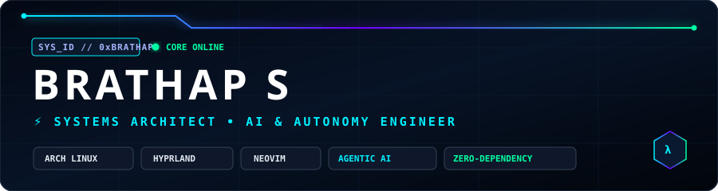
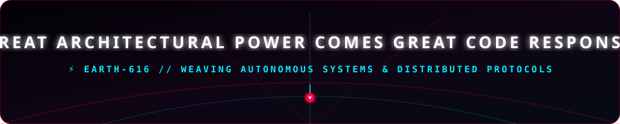

<div align="center">

<!-- THREE.JS HOLOGRAPHIC SPIDER-MAN HERO CENTERPIECE -->
<a href="https://github.com/Brathap">
  
</a>

<br><br>

<!-- SPIDER-VERSE VECTOR HERO BANNER -->


<br><br>

<!-- DYNAMIC SPIDER-SENSE STREAM -->
<a href="https://github.com/Brathap">
  
</a>

<br><br>

<!-- SPIDER-VERSE THEMED STATUS BADGES -->
<a href="https://github.com/Brathap">
  
  
  
  
</a>

<br><br>

<!-- TELEMETRY COUNTERS -->
<a href="https://github.com/Brathap">
  
  
  
</a>

</div>

---

<div align="center">

```text
 🕸️════════════════════════════════════════════════════════════════════════════🕸️
   ██████╗ ██████╗  █████╗ ████████╗██╗  ██╗ █████╗ ██████╗   SUIT: SYMBIOTE-V3
   ██╔══██╗██╔══██╗██╔══██╗╚══██╔══╝██║  ██║██╔══██╗██╔══██╗  CORE: HYPRLAND-WAY
   ██████╔╝██████╔╝███████║   ██║   ███████║███████║██████╔╝  LINK: BASH // NEOVIM
   ██╔══██╗██╔══██╗██╔══██║   ██║   ██╔══██║██╔══██║██╔═══╝   STATUS: OSCILLATING
   ██████╔╝██║  ██║██║  ██║   ██║   ██║  ██║██║  ██║██║       SIGNAL: 100% NEON
   ╚═════╝ ╚═╝  ╚═╝╚═╝  ╚═╝   ╚═╝   ╚═╝  ╚═╝╚═╝  ╚═╝╚═╝       LOC: EARTH-616
 🕸️════════════════════════════════════════════════════════════════════════════🕸️
```

</div>

---

## 🕷️ `01 // THE MULTIVERSE PROTOCOLS`

<div align="center">

<table>
<tr>
<td width="25%" align="center">
<br>

<br><br>
<b>SYSTEMS WEAVING</b>
<br><br>
<sub>Linux Kernel Internals, Wayland/X11 Protocols, Desktop Hardware Automation</sub>
<br><br>
</td>

<td width="25%" align="center">
<br>

<br><br>
<b>AUTONOMOUS AI AGENTS</b>
<br><br>
<sub>Self-steering Tool-using Agents, Voice Loops, Real-Time Vision Streams</sub>
<br><br>
</td>

<td width="25%" align="center">
<br>

<br><br>
<b>CROSS-DIMENSIONAL APPS</b>
<br><br>
<sub>Flutter & Dart Mobile, Electron GPU Acceleration, Reactive UI Frameworks</sub>
<br><br>
</td>

<td width="25%" align="center">
<br>

<br><br>
<b>ZERO-DEPENDENCY CORE</b>
<br><br>
<sub>Standard-Library Pure Code, Multi-OS CI/CD Pipelines, High-Speed Native Builds</sub>
<br><br>
</td>
</tr>
</table>

</div>

---

## ⚡ `02 // THE TECH ARSENAL`

<div align="center">

### `LANGUAGES & RUNTIMES`
<p align="center">
  
  
  
  
  
  
  
</p>

### `FRAMEWORKS & DESKTOP`
<p align="center">
  
  
  
  
</p>

### `SYSTEMS & DEVOPS INFRASTRUCTURE`
<p align="center">
  
  
  
  
  
  
</p>

### `CLOUD & MULTIVERSE DATA`
<p align="center">
  
  
  
  
</p>

</div>

---

## 🕸️ `03 // SPIDER-SUITE: FLAGSHIP BUILDS`

<div align="center">

<table>
<tr>

<!-- PROJECT 1: AUTOTYPER -->
<td width="50%" align="center">

### ⌨️ [AutoTyper](https://github.com/Brathap/autotyper)
**Universal Zero-Dependency Keystroke Web-Shooter**

<a href="https://github.com/Brathap/autotyper">
  
</a>

<br>

- Pure standard-library native drivers: **Win32 `ctypes`** & **macOS AppleScript**.
- Full **Wayland (`wtype`)** & **X11 (`xdotool`)** auto-detection on Linux.
- Smart auto-indentation corrector, speech typing, and instant stop.
- Automated multi-OS `.exe` & Mac binary GitHub Actions builds.

<br>

`Python` `Win32 API` `AppleScript` `Wayland` `Automation`

</td>

<!-- PROJECT 2: JARVIS AI -->
<td width="50%" align="center">

### 🤖 [J.A.R.V.I.S. AI](https://github.com/Brathap/Jarvis_AI)
**Interactive Sci-Fi Desktop Autonomous Assistant**

<a href="https://github.com/Brathap/Jarvis_AI">
  
</a>

<br>

- Full interactive voice interface with futuristic HUD aesthetics.
- Real-time conversational AI loop with multimodal capabilities.
- Autonomous desktop and browser automation (YouTube, Google, Apps).
- Integrated Speech-to-Text & system task scheduler.

<br>

`Python` `SpeechRecognition` `Tkinter` `Automation` `AI`

</td>

</tr>

<tr>

<!-- PROJECT 3: ARCH HYPRLAND SETUP -->
<td width="50%" align="center">

### ⚡ [Arch-Hyprland-Setup](https://github.com/Brathap/Arch-Hyprland-setup)
**Spider-Shards Cyber Wayland Desktop Environment**

<a href="https://github.com/Brathap/Arch-Hyprland-setup">
  
</a>

<br>

- Highly optimized Arch Linux + Hyprland tiling window workflow.
- Custom neon "Cyber-Shards" Rofi app launcher and Waybar status bars.
- Seamless dual-monitor configuration with GPU-accelerated rendering.
- Tailored keyboard-first developer keybindings & terminal automation.

<br>

`Arch Linux` `Hyprland` `Wayland` `Bash` `Rofi` `Waybar`

</td>

<!-- PROJECT 4: WHATSAPP DESKTOP -->
<td width="50%" align="center">

### 💬 [WhatsApp Desktop Linux](https://github.com/Brathap/whatsapp-desktop)
**GPU-Accelerated Wayland-Native Desktop Client**

<a href="https://github.com/Brathap/whatsapp-desktop">
  
</a>

<br>

- Native Wayland & AMD GPU hardware acceleration support.
- Instant clipboard synchronization & seamless screen-sharing.
- Ultra-low memory footprint with smooth continuous scrolling.
- Native system tray notifications and audio routing.

<br>

`Electron` `JavaScript` `Wayland` `Linux` `AMD-GPU`

</td>

</tr>

<tr>

<!-- PROJECT 5: WILD SIGHT -->
<td width="50%" align="center">

### 👁️ [Wild-Sight](https://github.com/Brathap/wild-sight)
**Edge Computer Vision & Wildlife Neural Detection**

<a href="https://github.com/Brathap/wild-sight">
  
</a>

<br>

- Computer vision pipeline for real-time edge object detection.
- High-efficiency inference with low-latency event alerts.
- Built for standalone remote sensor units and automated telemetry.

<br>

`Python` `Computer Vision` `Dart` `Edge AI`

</td>

<!-- PROJECT 6: CHAT APP -->
<td width="50%" align="center">

### 📱 [Chat-App](https://github.com/Brathap/chat-app)
**Real-Time Reactive Flutter Messenger**

<a href="https://github.com/Brathap/chat-app">
  
</a>

<br>

- Reactive real-time message stream with sub-100ms sync latency.
- Cross-platform unified codebase targeting Android, iOS, and Web.
- Secure token-based session management and media attachment support.

<br>

`Flutter` `Dart` `Firebase` `Realtime DB`

</td>

</tr>
</table>

</div>

---

## 📊 `04 // SUIT TELEMETRY & METRICS`

<div align="center">


<br><br>


</div>

---

## 🏛️ `05 // THE SPIDER-CODE`

<div align="center">

<table>
<tr>
<td align="center" width="33%">

### `01`
### 🕸️ WEAVE
**Build interconnected, fault-tolerant networks and systems.**

</td>

<td align="center" width="33%">

### `02`
### ⚡ ACCELERATE
**Automate mundane friction into instant web-line execution.**

</td>

<td align="center" width="33%">

### `03`
### 🧪 TRANSCEND
**Leap across dimensions with zero external dependencies.**

</td>
</tr>

<tr>
<td align="center" width="33%">

### `04`
### 🎯 ACCURACY
**Precision in the core architecture prevents chaos in production.**

</td>

<td align="center" width="33%">

### `05`
### 🛡️ RESPONSIBILITY
**With great architectural power comes great accountability.**

</td>

<td align="center" width="33%">

### `06`
### 🚀 SHIP
**A working deployment beats an unswung web.**

</td>
</tr>
</table>

</div>

---

## 📡 `06 // TRANSMIT TO EARTH-616`

<div align="center">

```text
┌──────────────────────────────────────────────────────────────────────────────┐
│  brathap@arch:~$ ./web-signal.sh --dimension earth-616                       │
│                                                                              │
│  [✓] Spider-Sense: ONLINE & SYNCHRONIZED                                     │
│  [✓] Web-Shooters: PRIMED & COMPILING                                        │
│  [✓] Encryption Protocol: QUANTUM-NEON                                       │
│                                                                              │
│  Status: OPEN FOR HIGH-IMPACT COLLABORATIONS & SYSTEMS MISSIONS             │
└──────────────────────────────────────────────────────────────────────────────┘
```

<br>

<a href="mailto:brathaps12@gmail.com">
  
</a>
<a href="https://github.com/Brathap">
  
</a>

<br><br>

<!-- NATIVE VECTOR SPIDER-VERSE FOOTER -->


</div>
